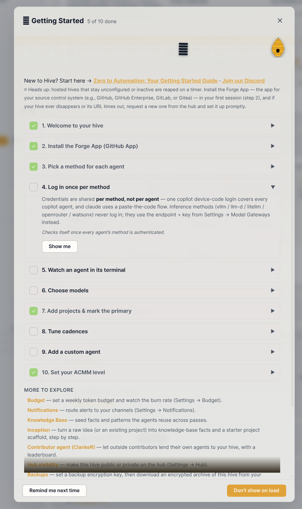

# Try Hive on an existing repo

A GitHub template for trying [Hive](https://github.com/hivecommons/hive). Make your own copy, then
follow this README to take it up the ACMM levels. It currently covers L2 → L3, ending with you
reviewing and accepting a pull request that a Hive agent wrote and held for you.

ACMM L1 is about creating your initial code. This repo already exists, so it starts at L2.

The repo stands in for one your team already has: a small Go service (a bookmarks API) with working
CI, decent but imperfect, and nothing Hive-specific in it. The walkthrough shows, by hand, each change
a team makes to its own repo to work with Hive, and the level at which it becomes necessary.

> Status: work in progress. The script that runs Hive against your copy is not written yet.

## What's in the repo

| Path | What it is |
|---|---|
| `main.go`, `handlers/`, `store/` | The sample service. Some of it is tested, some is not, and it has a bug or two for Hive to find. |
| `docs/API.md` | The service's API docs. |
| `.github/workflows/ci.yml` | CI: `go vet` and `go test` on every PR. |
| `setup/` | Files you apply by hand during the walkthrough: the `hold-gate` workflow and its ruleset. |
| `hive/` | Runs Hive in Docker against your copy: `compose.yaml`, Hive's starting config `hive.yaml`, and `demo-mode.sh`. |

Don't fix the service before you start: its gaps are what Hive's agents find.

## Getting started

Hive acts on GitHub as a **GitHub App** that you create once and install on your copy. You run the
admin steps as yourself, with your normal `gh` login.

### Why an App

- **The agent's PR is not yours.** Hive opens PRs as `<app-slug>[bot]`. GitHub never lets an author
  approve their own PR, so if Hive used your token, "a human accepts the agent's PR" would become "you
  merge your own PR". With the App, the bot opens the PR and you review, approve and merge it.
- **No second account.** No signup, email or 2FA to manage.
- **Narrow access.** The App is installed on your copy only, with only the permissions you give it
  in step 3. Hive mints its own short-lived tokens from the private key; there is no long-lived bot
  token.
- **It cannot touch CI.** The App has no Workflows permission, so GitHub refuses any push from it
  that touches `.github/workflows/`. Hive can never change the checks that judge its own work.

### 1. Give your `gh` login the admin scopes

```sh
gh auth refresh --hostname github.com --scopes repo,delete_repo
gh auth status                 # check the scopes line
```

- `repo`: create your copy, open issues and pull requests.
- `delete_repo`: delete your copy when you are done.

If your copy will live in an organisation, you must be able to create repositories and GitHub Apps
in it.

### 2. Make your copy

Click **Use this template** on GitHub, or:

```sh
gh repo create <you>/hive-demo --template hivecommons/hive-demo --public --clone
cd hive-demo
```

Make it public: rulesets on private repos need a paid plan. Run every command below from inside
your clone; `gh` works out the repo from there.

### 3. Create the App

Signed in to GitHub as the owner of your copy, go to **Settings → Developer
settings → GitHub Apps → New GitHub App** (<https://github.com/settings/apps/new>). For an
organisation, use the organisation's **Settings → Developer settings → GitHub Apps** instead.

Fill in the form, top to bottom:

- **GitHub App name**: anything unique across GitHub, e.g. `<you> Hive Demo`. The App's slug (used
  in its URLs, and as `HIVE_GITHUB_APP_SLUG` later) is this name in lower case with hyphens.
- **Description**: optional.
- **Homepage URL**: anything, e.g. `https://github.com/hivecommons/hive`.
- **Identifying and authorizing users**: leave **Redirect URI** empty and the checkboxes as they
  are (Device Flow and the OAuth-during-installation request both off). Hive does not sign users in
  through the App.
- **Post installation**: leave **Setup URL** empty and **Redirect on update** unticked.
- **Webhook**: untick **Active**. The **Webhook URL** field then stops being required. Hive polls
  GitHub, and finds the installation by itself.
- **Permissions → Repository permissions**: click the section to expand it, then set:

  | Permission | Access | Why |
  |---|---|---|
  | Contents | Read and write | Clone, branch and push the L3 PR |
  | Issues | Read and write | The advisory tracking issue, labels |
  | Pull requests | Read and write | Reviews at L2, the PR at L3 |
  | Actions | Read-only | Read CI results |
  | Checks | Read-only | Read CI results |
  | Commit statuses | Read-only | Read CI results |
  | Metadata | Read-only | Set automatically; required by GitHub |
  | Workflows | **No access** | See "Why an App" |

  Leave everything else at **No access**, including **Organization permissions** and **Account
  permissions**.
- **Subscribe to events**: leave all unticked (there is no webhook to send them to).
- **Where can this GitHub App be installed?**: **Only on this account**.

Click **Create GitHub App**. The App's settings open, with a sidebar (**General**, **Permissions &
events**, **Credentials**, **Optional features**, **Advanced**, **Install App**, **Public page**):

1. On **General**, note the **App ID**. The slug is the last part of the App's public URL
   (`https://github.com/apps/<slug>`); **Public page** in the sidebar opens it.
2. On **Credentials → Key pairs**, click **New key**. The browser downloads a `.pem` private key.
   Move it into place:

   ```sh
   mkdir -p secrets
   mv ~/Downloads/<downloaded-file>.pem secrets/gh-app-key.pem
   chmod 600 secrets/gh-app-key.pem
   ```

   Run this in your clone. `secrets/` is git-ignored. Anyone with this file can act as the App.

You install the App on your repo later, as one of the demo steps.

### 4. Set the environment variables

Set these in the shell you run Hive from. Nothing stores them; set them again in a new shell.

```sh
export HIVE_REPO=$(gh repo view --json nameWithOwner --jq .nameWithOwner)   # your copy, e.g. you/hive-demo
export HIVE_GITHUB_APP_ID=<App ID>               # from step 3
export HIVE_GITHUB_APP_SLUG=<slug>               # from step 3
export HIVE_DASHBOARD_TOKEN=$(openssl rand -hex 24)
```

`HIVE_DASHBOARD_TOKEN` is the password for the Hive dashboard and API; holding it is owner access.
Any long random string works. Keep it if you want to reuse a running Hive from another shell.

### 5. Install the App on your copy

Hive writes to the repo as the App from its first start, so the App has to be installed on it.

Open your Apps at <https://github.com/settings/apps>, click **Edit** on the App, then **Install App**
in its sidebar (the App's install page is also at `https://github.com/apps/<slug>/installations/new`).

Choose **Only select repositories**, pick your copy, and click **Install**.

If you have installed the App before (on an earlier copy), the same page opens the installation's
**Configure** screen instead. Add the new repo under **Repository access** and save.

Nothing to configure in Hive for this: it finds the installation itself.

### 6. Start Hive

Hive runs in a single container, from [`hive/compose.yaml`](hive/compose.yaml), using the variables
from step 4 and the App key in `secrets/`. It needs Docker with Compose, or Podman with
`docker compose`.

```sh
docker compose -f hive/compose.yaml up -d
docker compose -f hive/compose.yaml ps      # wait for "healthy", up to two minutes on first start
```

Open <http://127.0.0.1:3001> and sign in with `$HIVE_DASHBOARD_TOKEN`.

**1. Sign in to Claude.** In the **Getting Started** checklist, open **4. Log in once per method**,
click **Show me**, and follow Claude's sign-in: open the link, approve, and paste the code back.
Then close the checklist.



**2. Put Hive in demo mode.** Hive is built to run continuously, not to be tried in an afternoon.
This script does the things the walkthrough should not have to:

```sh
hive/demo-mode.sh
```

- It skips Claude Code's first-run screens for every agent. Each agent is its own Claude Code
  instance with its own settings, which is what lets each use a different model, and each would
  otherwise stop on them once.
- It lets scanner comment on the issues it diagnoses. Hive normally allows that only from L4; the
  demo needs it at L2.
- It restarts every agent, so they pick up your sign-in now rather than in a few minutes.
- It makes Hive check every minute instead of every ten, so findings reach the advisory issue soon
  after an agent finishes.

## The demo

At ACMM L2, Hive acts on what people bring to the repo: it responds to issues and reviews pull
requests, but changes nothing. A maintainer still decides and does the work.

Two agents do this:

| Agent | Runs | Does |
|---|---|---|
| **scanner** | every 4 hours | reads new issues, works out the cause in the code, and comments on the issue with a diagnosis and a plan |
| **reviewer** | every 30 minutes | reviews pull requests and comments on them (never approves or merges) |

Both run on their schedules, or you can run them now. Watch either work in its terminal on the
dashboard (username `hive`, password `$HIVE_DASHBOARD_TOKEN`).

(The other L2 agents, guide, quality and supervisor, also run, and post what they find to a
**🐝 Hive Advisory Report** issue Hive opens on your repo.)

### 1. An issue is raised

Open a new issue on your repo, the way a user reporting a bug would:

- **Title:** Page 1 of /bookmarks skips my first bookmarks
- **Description:** With 25 bookmarks, GET /bookmarks?page=1 returns bookmarks 21-25. The first 20
  never show up.

### 2. Hive comments on the issue

Scanner looks at new issues every four hours. Run it on yours now:

```sh
ISSUE=$(gh issue list -R "$HIVE_REPO" --limit 1 --json url --jq ".[0].url") && echo "$ISSUE"
curl -X POST -H "Authorization: Bearer $HIVE_DASHBOARD_TOKEN" -H "Content-Type: application/json" \
  -d "{\"prompt\":\"Read /data/policies/scanner-issues.md and follow it as your instructions. Your work list is this issue: $ISSUE. The repo is https://github.com/$HIVE_REPO: clone it into your workdir.\"}" \
  http://127.0.0.1:3001/api/kick/scanner
```

Now open the issue. You should see scanner's comment: the cause in `store/store.go` (`List` treats
page 1 as if pages started at 0) and how to fix it.

### 3. A pull request is raised

Fix the bug the way scanner suggests, and open a pull request:

```sh
git switch -c fix-first-page
sed -i 's/start := page \* size/start := (page - 1) * size/' store/store.go
git commit -am "Fix page 1 of /bookmarks skipping the first page of results"
git push -u origin fix-first-page
PR=$(gh pr create --fill) && echo "$PR"
```

### 4. Hive comments on the pull request

Reviewer reviews pull requests every 30 minutes. Run it on yours now:

```sh
curl -X POST -H "Authorization: Bearer $HIVE_DASHBOARD_TOKEN" -H "Content-Type: application/json" \
  -d "{\"prompt\":\"Read /data/policies/reviewer-queue.md and follow it as your instructions. Your work list is this pull request: $PR. The repo is https://github.com/$HIVE_REPO: clone it into your workdir.\"}" \
  http://127.0.0.1:3001/api/kick/reviewer
```

Now open the pull request. You should see reviewer's review as comments, citing the lines it is
talking about; expect it to point out that the fix has no test. Merge when you are happy:

```sh
gh pr merge --squash --delete-branch
git switch main && git pull
```

### What's next

The next ACMM levels have Hive measure the code and running system and raise issues itself (L3),
manage its own findings (L4), and then raise pull requests from issues (L5). They are beyond this
walkthrough.

## Stopping and starting again

### Stop Hive

When you are done for now:

```sh
docker compose -f hive/compose.yaml down
```

This keeps everything Hive has stored: its level, findings, knowledge base and the Claude sign-in.
`docker compose -f hive/compose.yaml up -d` later carries on where you left off.

### Reset Hive

> **This deletes everything Hive has stored**, including the Claude sign-in and the current level.
> You sign in to Claude and press Enter through each agent's first-run screen again.

```sh
docker compose -f hive/compose.yaml down -v
```

You need it to go back to L2 after promoting, or for an edit to `hive/hive.yaml` to take effect:
Hive reads that file only on its first start, then keeps and updates its own copy.

### Start over with a new copy

> **This deletes your copy of the repo, with every issue and PR in it.**

Reset Hive (above), then delete your copy, make a new one (step 2) and add it to the App's
installation (step 5):

```sh
gh repo delete <you>/hive-demo --yes
```

To remove the App too, delete it from **Advanced** in its settings sidebar, and delete
`secrets/gh-app-key.pem`.
